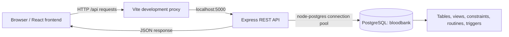
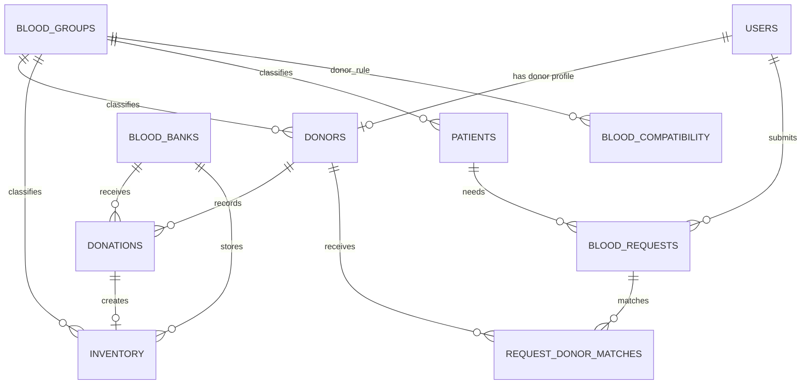

# BloodBank Database Demo Guide

This guide is for presenting the BloodBank capstone database and showing how the website, API, and PostgreSQL database work together.

## What the project uses

- **DBMS:** PostgreSQL 18.6
- **Database:** `bloodbank`
- **Local server:** `localhost:5432`
- **Current data folder:** `C:/Program Files/PostgreSQL/18/data`
- **Backend:** Node.js + Express REST API on port `5000`
- **Frontend:** React + Vite (usually port `5173` or the next available port)

The database runs on this computer. It is not stored in the GitHub repository. The project repository contains the schema, safe sample seed data, and migration scripts; the live records are stored by PostgreSQL in its data folder. Connection credentials stay in `backend/.env` and are not committed.

## How the parts connect



For the live demo, start PostgreSQL first, then run each app part in its own terminal:

```powershell
# Terminal 1: from the backend folder
cd backend
npm run dev

# Terminal 2: from the frontend folder
cd frontend
npm run dev
```

Open the frontend URL printed by Vite (usually `http://localhost:5173`; if that port is busy, Vite prints another one). Sign in and open a dashboard screen that loads data; the browser sends an API request, the backend queries PostgreSQL, and the API returns JSON to render. The backend terminal should say `PostgreSQL connected`.

## Database design

The database has **11 application tables**, plus one schema migration tracking table. The core relationships are:



| Table | Purpose |
|---|---|
| `users` | Login identity, hashed password, role and contact details |
| `donors` | Donor profile, eligibility and location |
| `donations` | Donation event ledger (source of truth for donor history) |
| `blood_banks` | Blood collection/storage centers |
| `inventory` | Individual blood bags, expiry and availability status |
| `patients` | Patient details needed for requests |
| `blood_requests` | Requested group, units, urgency and fulfillment progress |
| `request_donor_matches` | Junction table recording donor matches and responses |
| `blood_groups` | Valid blood group lookup values |
| `blood_compatibility` | Donor-to-recipient compatibility lookup (27 valid pairs) |
| `audit_log` | Before/after snapshots for inventory and request changes |

This design separates repeating data into related tables. Primary keys identify rows; foreign keys keep relationships valid; `request_donor_matches` models the many-to-many relationship between requests and donors. Checks restrict roles, age, blood groups, statuses, donation volume and request quantities. Unique rules prevent duplicate email identities, donor profiles, bank identities, request/donor matches, and duplicate inventory links to one donation.

## DBMS features to point out

- **Views:** `vw_available_stock`, `vw_eligible_donors`, `vw_pending_requests`, `vw_expiring_soon` give reusable report-ready results.
- **Indexes:** speed up searches for donor location/group, eligible stock, request status, and donation history.
- **Stored routines:** matching functions find compatible donors and units; `sp_register_donation` records a donation and creates its stock unit; `sp_fulfill_request` validates compatibility, expiry, availability and remaining quantity before issuing stock.
- **Triggers:** maintain timestamps, set inventory expiry, keep donor totals/dates synchronized with the donation ledger, and audit inventory/request changes.
- **Transactions and row locks:** donation and request fulfillment operations stay consistent when multiple updates must succeed together, including concurrent attempts.
- **Migrations:** `schema_migrations` records applied database changes. SQL changes are in `backend/src/db/migrations/`.
- **Authentication:** passwords are stored as bcrypt hashes; JWTs protect API routes. The database stores the hash, never the plain password.

## Open it in pgAdmin

1. Start the Windows service named **postgresql-x64-18** (or open Services and start the PostgreSQL 18 service).
2. Open **pgAdmin 4**. If the server is not listed, register one with host `localhost`, port `5432`, maintenance database `postgres`, and the PostgreSQL username/password configured for this computer.
3. Expand **Servers → PostgreSQL → Databases → bloodbank → Schemas → public**.
4. Under **Tables**, inspect rows with right-click → **View/Edit Data → All Rows**. Start with `users`, `donors`, `donations`, `inventory`, and `blood_requests`.
5. Under **Views**, open `vw_available_stock` or `vw_pending_requests`. Under **Functions/Procedures**, inspect matching and fulfillment routines. `audit_log` shows recorded stock/request changes.

Do not paste passwords into a presentation or commit `backend/.env`. If you do not know the local PostgreSQL password, use the credentials already configured in `backend/.env`; do not display the file in class.

## Quick status and report

From the `backend` folder:

```powershell
npm run db:status
```

This prints the connected database/server, PostgreSQL data directory, table row counts, schema object counts, and integrity checks without printing user records or credentials.

In pgAdmin's Query Tool, these read-only queries are useful for a short explanation:

```sql
-- Blood units currently available, grouped by group and blood bank
SELECT * FROM vw_available_stock ORDER BY blood_group, bank_name;

-- Requests that still need attention
SELECT * FROM vw_pending_requests ORDER BY urgency, request_date;

-- See donation events and the donor profiles they belong to
SELECT d.donor_id, u.name, d.blood_group, n.donation_date, n.volume_ml
FROM donors d
JOIN users u ON u.user_id = d.user_id
JOIN donations n ON n.donor_id = d.donor_id
ORDER BY d.donor_id, n.donation_date DESC
LIMIT 12;

-- Inspect the latest database audit events
SELECT table_name, operation, record_id, changed_by, changed_at
FROM audit_log ORDER BY changed_at DESC LIMIT 10;
```

## Current local database snapshot

The database was checked on **5 November 2026**. It contained 5 banks, 26 users, 20 donor profiles, 63 donation events, 35 inventory units, 10 patients, and 10 blood requests. The integrity report found no duplicate emails, duplicate donor profiles, invalid request totals, expired units marked available, or donor-history mismatches. Counts change as the app is used; run `npm run db:status` for the latest values.

## Short teacher explanation

> “The application uses PostgreSQL as its relational DBMS. The React frontend sends requests to an Express API, and the API reads or changes records in the `bloodbank` database. The schema uses primary and foreign keys, lookup tables, constraints, indexes, views, stored routines, triggers, transactions and an audit log. Donation events are the source of truth for donor history, while inventory rows represent individual blood units. I can show the live data and reports in pgAdmin, and `npm run db:status` gives a privacy-safe integrity summary.”

## Safe setup commands

`npm run init-db` creates/updates the schema and applies migrations, then loads demo seed data only if the application tables are empty. It does not truncate existing records. `npm run init-db:schema` applies schema/migrations without seeding; `npm run init-db:seed` skips seeding if application data already exists. Always use these project commands rather than running `seed.sql` manually against a database with real records.
