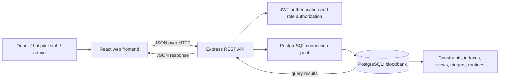

# Product Requirements Document

## Hemora — Blood Bank and Donor Matching System

| Document field | Value |
|---|---|
| Project type | Student capstone / DBMS application |
| Product name | Hemora (BloodBank system) |
| Document status | Current-state PRD based on the project repository |
| Revision date | 5 November 2026 |
| Platform | Responsive web application |

## 1. Product summary

Hemora is a web application for organizing blood donor information, donations, blood bank inventory, and patient blood requests in one connected system. Hospital staff can submit and track requests; donors can register and keep a donor profile; authorized staff can review matching donors and available stock. The application uses a React frontend, an Express API, and a PostgreSQL relational database.

This is an academic project and demonstrator. It illustrates how a web interface, REST API, authentication, relational data design, and database operations fit together. It is not a substitute for a regulated clinical or blood transfusion service.

## 2. Problem and opportunity

Blood donation and request information can be difficult to coordinate when people, stock, and requests are tracked separately. A central system can make this information easier to find, connect compatible donors or units to a request, and show whether requests are still waiting or have been fulfilled.

The project focuses on demonstrating those workflows and the DBMS concepts behind them: related tables, keys, constraints, views, indexes, stored routines, triggers, transactions, and audit history.

## 3. Product goals

1. Provide one place to register donors, record donations, manage blood bank stock, and track patient requests.
2. Help staff identify eligible donors and compatible available inventory.
3. Make request and stock status visible through dashboards, lists, and reports.
4. Preserve valid relationships and business rules in PostgreSQL, not only in the browser.
5. Provide a polished, accessible interface that clearly explains the status of important work.
6. Make the project understandable and demonstrable as a DBMS capstone.

### Measures of success

- A user can register and sign in through the API-backed authentication flow.
- Dashboard and list pages display data returned by the API and PostgreSQL.
- A donor, donation, inventory unit, and request can be followed through their related records.
- A request cannot be fulfilled with expired, unavailable, incompatible, duplicate, or excessive inventory units.
- Database integrity checks report no duplicate email identities, duplicate donor profiles, invalid request totals, expired stock marked available, or donor-history count mismatches.
- A student can show the schema, live records, reporting views, and app-to-database flow in a short demonstration.

## 4. Users and roles

### Donor

Creates an account and donor profile, provides blood group and location, and can be considered for matching when eligible. Donor registration fields include name, email, password, blood group, age, gender, city, and state; phone and address are also collected where provided.

### Hospital staff

Creates and reviews patient blood requests, checks matching donors and available stock, and tracks request status. The API restricts selected operations by role.

### Administrator

Has elevated access for operations such as managing banks, inventory statuses, donor records, and request fulfillment. Admin capabilities are enforced by backend authorization middleware.

### Project demonstrator

The student or teacher inspects the application, API behavior, PostgreSQL schema, sample records, views, database routines, and integrity report.

## 5. Scope

### Included in the current project

- Responsive React interface with dashboard and navigation.
- Light and dark appearance toggle.
- Account registration for donors and hospital staff.
- Email/password and mobile-number/password sign-in.
- Optional Google sign-in when Google OAuth configuration is provided.
- JWT-based API authentication and role checks.
- Donor directory, donor profile and donation history.
- Blood bank directory and bank stock views.
- Donation recording and inventory management.
- Patient blood request creation, listing and status tracking.
- Compatible donor matching and request donor notifications recorded by the system.
- Inventory unit selection and guarded request fulfillment.
- Dashboard counts, blood group stock meters, request-status visualization, donation trend chart, and report endpoints.
- PostgreSQL schema initialization, safe demo seeding, versioned migration, and a database status report.

### Outside the current project scope

- Real SMS/phone one-time-password sign-in. Phone sign-in currently uses a password.
- Google sign-in until valid Google OAuth client IDs are configured.
- Real-time SMS, email, or push notifications to donors.
- Live integration with hospital, laboratory, or government systems.
- Clinical verification, compatibility testing, medical approval, or patient care decisions.
- Payments, appointment scheduling, courier logistics, or donor rewards.
- Multi-tenant hosting, cloud database deployment, production backup operations, or disaster recovery.
- A guarantee that sample/demo records represent real availability.

## 6. Current user journeys

### 6.1 Register and sign in

1. A visitor opens the registration page and chooses donor or hospital staff.
2. The frontend validates required fields and submits them to the registration API.
3. The backend validates the request, hashes the password, and stores the account and applicable donor profile in PostgreSQL.
4. On success, the API returns a signed JWT and user summary; the frontend stores the session and opens the dashboard.
5. A returning user can sign in by email or mobile number plus password. Optional Google credential sign-in is available when configured.

### 6.2 Record a donation and stock unit

1. An authorized user selects a donor and blood bank.
2. The API calls the donation database routine.
3. PostgreSQL checks donor eligibility and active status, creates the donation event, and creates a corresponding inventory unit.
4. A trigger synchronizes donor donation count and most recent donation date from the donation ledger.
5. The dashboard and inventory screens show the resulting stock and donation activity.

### 6.3 Create and fulfill a blood request

1. Hospital staff enters patient/request information, requested blood group, unit count, location, and urgency.
2. The backend stores the patient and request with their user relationship.
3. Staff can request compatible donor matches and review compatible inventory.
4. An authorized administrator selects units to fulfill all or part of a request.
5. The database routine locks the request and eligible inventory rows, verifies compatibility and expiry, and rejects invalid or excessive selections.
6. Inventory status and request fulfillment totals update together; audit triggers record important changes.

## 7. Functional requirements

Priority meanings: **P0** essential for core demonstration; **P1** important supporting behavior; **P2** optional or configuration-dependent. “Current state” describes repository implementation, not a production certification.

| ID | Requirement | Priority | Current state |
|---|---|---:|---|
| FR-01 | Visitors can register as a donor or hospital staff member with required fields validated. | P0 | Implemented |
| FR-02 | Users can sign in with email/password or mobile/password and receive a JWT session. | P0 | Implemented |
| FR-03 | Google sign-in is offered only when OAuth is configured and verified by the backend. | P2 | Optional configuration |
| FR-04 | Protected routes require authentication; restricted API actions require an allowed role. | P0 | Implemented in API middleware |
| FR-05 | Users can view a dashboard with system totals, stock levels, request status, and donation trends. | P0 | Implemented |
| FR-06 | Staff can browse and filter donors and view donor profiles/history. | P0 | Implemented in API and UI |
| FR-07 | Authorized users can record donations; successful donation recording creates a stock unit. | P0 | Implemented with database routine |
| FR-08 | Staff can view inventory summaries, available units, and units nearing expiry. | P0 | Implemented |
| FR-09 | Staff can create and review patient blood requests and track request status. | P0 | Implemented |
| FR-10 | The system can identify donors and inventory compatible with a requested blood group. | P0 | Implemented using compatibility data and routines |
| FR-11 | Authorized staff can notify/record a donor match against a request. | P1 | Implemented as an in-system match record; external delivery is out of scope |
| FR-12 | Fulfillment validates unit availability, expiry, compatibility, duplicates, and quantity still needed. | P0 | Implemented in database routine |
| FR-13 | Inventory and request changes on critical paths are written to an audit log. | P1 | Implemented for inventory and requests |
| FR-14 | Users can switch the interface between light and dark themes. | P1 | Implemented |
| FR-15 | Administrators can browse blood banks and manage supported bank records. | P1 | Implemented through role-protected API and bank views |
| FR-16 | Operators can inspect database connection details, row counts, schema object counts, and integrity summaries without exposing user records. | P1 | Implemented by `npm run db:status` |

## 8. Data and DBMS requirements

### Core entities

The PostgreSQL database `bloodbank` contains 11 application tables:

| Entity/table | Responsibility |
|---|---|
| `users` | Login identity, role, contact details, password hash |
| `donors` | Donor-specific profile and eligibility fields |
| `donations` | Source ledger of donation events |
| `blood_banks` | Collection and storage locations |
| `inventory` | Individual blood units, status, bank, and expiry |
| `patients` | Patient information referenced by a request |
| `blood_requests` | Blood group, quantity, urgency, and fulfillment state |
| `request_donor_matches` | Many-to-many link between requests and donors, with response state |
| `blood_groups` | Valid blood group lookup |
| `blood_compatibility` | Allowed donor-to-recipient blood group pairs |
| `audit_log` | Before/after snapshots for critical inventory/request operations |

The `schema_migrations` table tracks database upgrades and is infrastructure metadata rather than a business entity.

### Data rules

- Every record uses a primary key; related records use foreign keys.
- A user has at most one donor profile; email identities are unique case-insensitively.
- Blood group, role, gender, status, urgency, age, and volume values are constrained to valid ranges/sets.
- Donation history is the source of truth for donor lifetime count and latest donation date.
- A donation is linked to a bank and donor; where recorded through the donation workflow, it creates one inventory unit.
- Fulfillment cannot issue an expired, unavailable, incompatible, duplicate, or excess inventory selection.
- Indexes support common searches for donor location/group, stock availability/expiry, requests, and histories.
- Four views provide report-ready inventory, eligible donors, pending requests, and expiring stock.
- Triggers maintain timestamps/expiry, synchronize donor history, and audit critical stock/request changes.
- Transactions and row locks protect multi-record donation and fulfillment operations.

## 9. System design and architecture

The frontend owns display and client-side form feedback. The API owns request validation, authentication, authorization, and application orchestration. PostgreSQL owns persistent records and critical relational integrity/business rules. The frontend does not connect directly to PostgreSQL.

## 10. Non-functional requirements

### Security and privacy

- Store passwords as bcrypt hashes, never as plaintext.
- Require signed JWTs for protected endpoints and role checks for restricted operations.
- Use parameterized SQL for user-provided values.
- Keep database credentials, JWT signing secrets, and OAuth secrets outside source control.
- Avoid exposing sensitive personal data in health/status reports.
- Treat the current local sample database as a classroom demonstration, not production patient data.

### Integrity and reliability

- Use foreign keys, unique constraints, checks, transactions, and row locks to prevent inconsistent updates.
- Make schema changes through numbered migrations.
- Database initialization must not truncate or overwrite an existing populated database.
- Provide a readable error response when the API or database is unavailable.

### Usability and accessibility

- Provide clear labels and required-field feedback on forms.
- Use status labels, charts/meters, tables, and empty/loading/error states to explain system data.
- Support responsive layouts and keyboard-usable controls.
- Provide sufficient contrast in both light and dark themes.

### Maintainability

- Keep frontend, API routes, database setup, migrations, and documentation in separate project areas.
- Expose a health endpoint at `/api/health`.
- Provide a repeatable setup flow and database status command.

## 11. Acceptance criteria for a classroom demonstration

1. The PostgreSQL service starts and the `bloodbank` database is visible in pgAdmin.
2. The backend starts and reports a successful PostgreSQL connection.
3. The frontend loads using the Vite URL and renders authenticated dashboard data.
4. A user can show the data journey from donor to donation to inventory, and from patient to request to fulfillment.
5. The student can open a database view and explain its report value.
6. The database status command runs and shows current table counts and integrity checks.
7. Invalid fulfillment attempts are rejected by the API/database rules and do not partially update inventory.
8. No secrets are shown in the presentation or committed to GitHub.

## 12. Assumptions, constraints, and risks

- Current local configuration uses a PostgreSQL service installed on the development computer.
- Demo/sample records may not represent actual donors, inventory, banks, or medical availability.
- Phone/password authentication is not phone-number verification; there is no OTP flow.
- Google authentication depends on OAuth credentials and correct authorized-origin configuration.
- API route authorization should be reviewed before any real deployment, especially donor data access and role-specific visibility.
- A production deployment would require a privacy/security review, consent and retention policies, secure hosting, backups, monitoring, and domain-specific validation.
- Medical compatibility rules and operational blood handling require expert/regulated validation before any real-world use.

## 13. Future opportunities

1. Add OTP verification and account recovery with a verified messaging provider.
2. Add donor consent, availability preferences, and notification opt-in/opt-out.
3. Add real notification delivery and delivery status tracking.
4. Add stronger role-specific dashboards and access controls for personal data.
5. Add database backup/restore instructions and automated migration/deployment workflow.
6. Add audit coverage for all sensitive record changes and authenticated actor attribution.
7. Add production monitoring, rate limiting, security headers, and automated API/database integration checks.
8. Obtain domain expert review of compatibility and eligibility rules before real-world use.

## 14. Demo and project references

- [Database demo and pgAdmin guide](DATABASE_DEMO_GUIDE.md)
- Database schema: `backend/src/db/schema.sql`
- Database seed records: `backend/src/db/seed.sql`
- Integrity migration: `backend/src/db/migrations/001_integrity_hardening.sql`
- Safe initializer: `backend/src/db/init.js`
- Database status report: run `npm run db:status` from `backend/`
- API health check: `GET http://localhost:5000/api/health`

